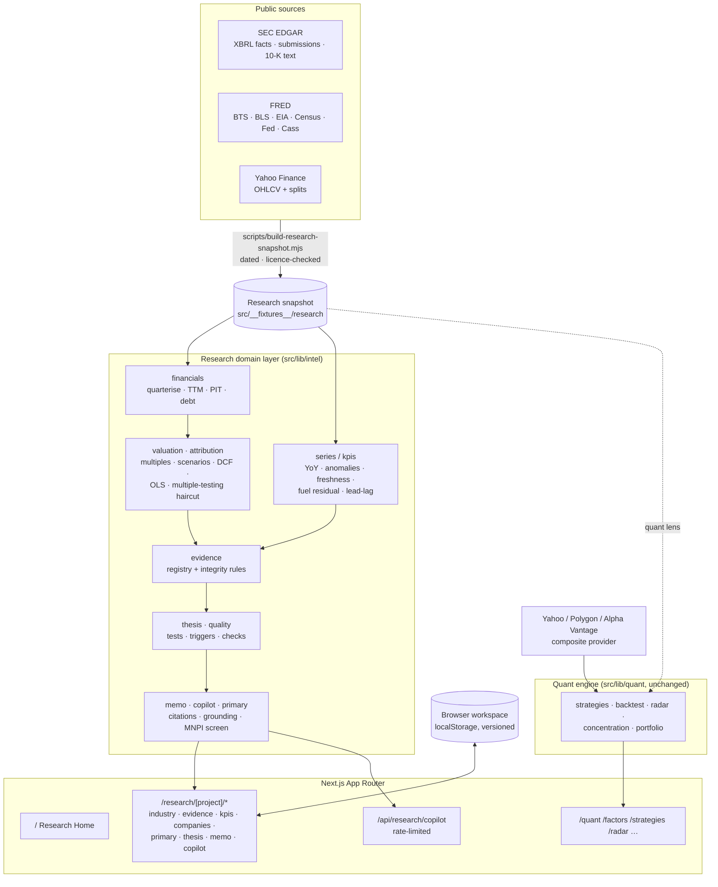
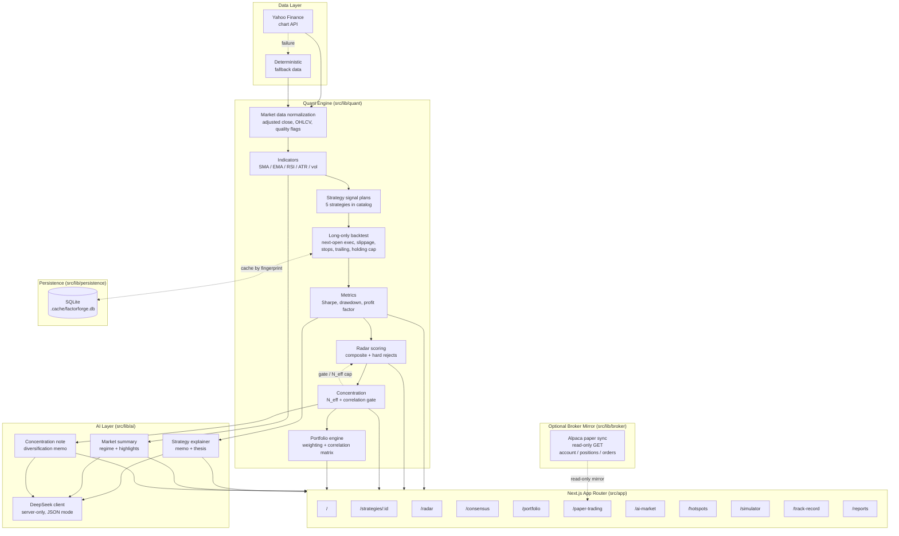

# FactorForge

> **AI-Native Equity Research & Market Intelligence.** A research-first workspace that takes an analyst from information to evidence, from evidence to a testable thesis, and from the thesis to a risk-aware decision and an honest outcome review. It is built on a quantitative factor and backtesting engine.

[](https://github.com/bobaoxu2001/FactorForge/actions/workflows/ci.yml)
[](https://nextjs.org)
[](https://www.typescriptlang.org)
[](#testing)

**Live demo:** [factor-forge-ashy.vercel.app](https://factor-forge-ashy.vercel.app/) (currently deployed from `main`, which predates the research platform described here; see [Deployment](#deployment)).

> Independent research software for educational and research use. **Not investment advice.** FactorForge is not affiliated with, or endorsed by, any company, data provider or research firm it cites. It places no trades and has no order-execution path. Backtests are in-sample research tools, not performance records.

---

## What changed: from quant lab to research platform

FactorForge started as a quant strategy lab (factor discovery, cost-aware backtests, radar screening, a simulated model portfolio). That engine is intact under **Quantitative**. On top of it sits a research domain layer (`src/lib/intel`) and a workflow organised around how institutional research is actually done:

```
Select industry → understand the value chain → explore companies → inspect real evidence
  → analyse KPIs → evaluate competing hypotheses → write the memo → assess investment implications
```

Design rules enforced in code and tests:

- **Every number traces to a dated, attributable source**: SEC EDGAR XBRL facts with accession numbers, FRED series with their licence and release dates, Yahoo prices.
- **Every claim states what kind of thing it is**: public evidence, *your* primary research, AI-generated work product, or hypothesis. AI output can never be marked verified.
- **No invented precision**: no composite AI scores. Quality checks are pass/warn/fail with reasons. Scenario probabilities stay blank until an analyst writes a justification.
- **Point-in-time integrity**: historical valuation uses only fundamentals filed by each date; restatements are surfaced, not silently applied.

See [`docs/PROJECT_AUDIT.md`](docs/PROJECT_AUDIT.md) for the audit that motivated the change and [`docs/RESEARCH_PLATFORM_ARCHITECTURE.md`](docs/RESEARCH_PLATFORM_ARCHITECTURE.md) for the design.

## Featured case study: *Is the U.S. Freight Recovery Real?*

`/research/freight`: a complete, working research project on U.S. trucking and freight.

| Stage | Route | What it does |
|---|---|---|
| Overview | `/research/freight` | Research question, workflow status, computed variant view, hypothesis scorecard, KPI monitor, catalysts, quality checks |
| Industry map | `/industry` | Interactive value-chain graph. 12 of 14 relationships are **verified** against verbatim 10-K sentences; the others are marked inferred or hypothetical |
| Evidence | `/evidence` | Evidence Explorer: filter ~95 items by origin, status and hypothesis; trace any claim to its SEC filing or FRED series; see where the memo cites it |
| KPIs | `/kpis` | 13 freight KPIs (BTS/ATA tonnage, Cass, BLS PPIs, EIA diesel, BLS payrolls, Fed IP, Census) with full metadata, freshness vs release cadence, ≥2σ anomaly flags, an out-of-sample **fuel-adjusted pricing residual**, and a lead-lag explorer with split-half stability and a holdout test |
| Competitive intel | `/companies` | KNX, JBHT, CHRW (+ ODFL, SNDR, WERN, LSTR): growth, margins, FCF, leverage, ROIC, point-in-time valuation percentiles. No composite score |
| Company research | `/companies/[ticker]` | Quarterly table with derivation markers, TTM cash flow, debt by XBRL component, 5-year PIT multiples, bull/base/bear scenarios, sensitivity grid, interactive DCF, filings & estimated earnings dates, market/sector attribution, and the quant lens with a multiple-testing haircut |
| Primary research | `/primary` | Channel-check plan (stakeholders × hypotheses), interview guides, compliance safeguards, and a private workspace for **your** interview notes with MNPI/PII screening, theme and indicator extraction, contradiction detection and cross-source comparison |
| Thesis & decision | `/thesis` | Hypothesis tests, invalidation triggers (monitored), scenario ranges, correlation/liquidity context, and a look-ahead-free outcome review (market vs sector vs residual) |
| Memo | `/memo` | 19-section institutional memo with live citations, status (*exploratory / draft–incomplete verification / evidence-backed*), editable sections, Markdown export |
| Copilot | `/copilot` | Grounded research copilot (14 workflows) with a citation validator |

**What the committed snapshot (built 2026-11-01) shows.** These are computed findings, not opinions. They change when the snapshot is refreshed.
- Headline truckload pricing is up strongly year over year (BLS PPI), but it rose *less* than its historical diesel sensitivity implies: the fuel-adjusted residual is negative. The pricing "recovery" looks like fuel-surcharge pass-through, not a linehaul rate cycle. Diesel's move is outside the model's training range, so read the sign, not the size.
- Volume measures are flat to mixed (tonnage, Cass shipments, Freight TSI, rail carloads).
- Truck-transportation payrolls are still slightly down year over year: slow capacity attrition.
- Margin changes diverge by company rather than by business model. The focus names have underperformed SPY over six months and are not at valuation extremes.
- No interviews have been conducted, so the memo is honestly labelled **"Research draft — incomplete verification"**. The primary-research page is a plan, not fabricated findings.

## Research platform: data sources

| Source | Used for | Access & terms |
|---|---|---|
| **SEC EDGAR** XBRL `companyfacts` + `submissions` + latest 10-K text | Quarterly financials (point-in-time, restatement-aware), filing index, 8-K Item 2.02 earnings dates, verbatim business-description excerpts | Public; fair-access policy requires a contact User-Agent (`SEC_EDGAR_USER_AGENT`, builder only, never stored) |
| **FRED** (St. Louis Fed) series + series pages | Freight KPIs from BTS, BLS, EIA, Census, Federal Reserve and Cass Information Systems; units, frequency, release, last-updated and next-release dates | Licence captured per series. "Pre-approval required" series are excluded automatically. Cass data are copyrighted and shown with citation, as FRED's terms require |
| **Yahoo Finance** chart API | Daily OHLCV + split events for valuation (raw price reconstructed) and returns | Unofficial keyless endpoint, research use |
| **DeepSeek** (optional) | Copilot prose under a citation validator | `DEEPSEEK_API_KEY`; deterministic fallback otherwise |

Snapshots live in `src/__fixtures__/research/<project>/` and are rebuilt by `npm run research:refresh` (and weekly in CI when the `SEC_EDGAR_USER_AGENT` secret is set). Not connected, and shown as explicit gaps: spot/contract rate feeds, tender rejections, Class 8 orders, consensus estimates, earnings-call transcripts (all licensed), and FMCSA authority data (public; adapter not built).

## Research methodology safeguards

- **Quarterisation is explicit.** Values come from direct 3-month facts where filed. Otherwise they are derived from YTD differences (†) or FY − 9M (‡), and every derived value says so.
- **One XBRL concept per metric per company**, chosen by recent coverage and displayed. Debt is a shown sum of named components, with known exclusions.
- **Freshness**: each KPI is fresh/lagging/stale against its release cadence and publication lag. The price fixture flags itself stale when old.
- **Comparability**: YoY by calendar period, never by array offset. NSA series are read YoY only. Lead-lag is labelled in-sample with a split-half stability check and a holdout test (lag chosen on the first two-thirds, tested on later months), and correlation is never called predictive.
- **Fuel-adjusted residual**: OLS fitted only on data before a 12-month holdout, with an extrapolation warning.
- **Valuation**: positive-denominator multiples only (negative-earnings P/E is "n/m", not cheap). Scenarios are anchored to each company's own 5-year history. Expected return is computed only from a complete, justified probability set.
- **Backtests**: labelled backtest vs simulated vs actual (actual is not supported). The best-of-N Sharpe is shown next to the expected maximum Sharpe of N skill-less strategies.
- **Attribution**: daily OLS on SPY and IYT−SPY. Outcome review estimates betas *before* the thesis date.
- **Primary research**: user notes stay in the browser, are screened for emails, phones, IDs and MNPI language, and contact details are redacted on save. Notes with possible MNPI are never sent to an AI model.
- **Copilot grounding**: every fact or calculation must cite an evidence ID that was retrieved for that request, or it is moved to "unsupported".

---

## Quantitative lab (pre-existing, retained)


| Module | What it does |
|---|---|
| **Model Portfolio Performance Since May** | A deterministic, equal-weighted blend of the top-ranked research strategies, normalized on the start date and benchmarked against SPY/QQQ. Simulated research portfolio only — not a real-money account. |
| **Market Stress Mode** | A selloff/stress research view (`/ai-market?demo=stress`) that diagnoses market regime, breadth deterioration, and drawdown pressure with a stress-aware research memo. |
| **Market Hotspots & Scenario Research** | Configured catalyst intelligence (`/hotspots`) — coverage-weighted hotspot signals and scenario forecasts across themes, with private labeling for pre-IPO names. |
| **Quant Screen** (`/picks`, formerly "AI Stock Picks") | Model-ranked cross-sectional selection (`/picks`) — every scored universe name ranked by a regime-aware blend of momentum, trend, stability, overheat balance, volume confirmation, multi-strategy evidence, and valuation/quality fundamentals (Yahoo quoteSummary with a committed, dated snapshot fallback), with per-component receipts and caveats. Deterministic scores; the LLM writes the reading on top. Relative evidence only — no price targets, not advice. |
| **Strategy Research Lab** | Five structurally different rule-based strategies with cost-aware backtests, in-sample/out-of-sample splits, factor-attribution regressions, and LLM strategy memos. |
| **Radar Screening** | Composite scoring, rejection rules, and a concentration gate (`N_eff`) that demotes near-duplicate candidates before they reach observation. |
| **Paper Observation** | Research-only simulated monitoring of radar-approved strategies, with a post-market Daily Review. No live orders. Optionally mirrors a **read-only Alpaca paper account** (account, positions, recent orders) when paper API keys are set — GET requests only, no order-submission path. |
| **Public Track Record** | A shareable, outside-viewer "receipt" (`/track-record`) of the simulated paper ledger: strategy-by-strategy results, observation dates, current marks, and guardrails. Not a broker statement, not advice, not live trading. |
| **Trade Simulator** | An interactive paper-trading desk (`/simulator`) — start with $100k of virtual cash, buy/sell any universe name at its latest close, and watch holdings, weights, and total return update live. State persists in the browser (no login, works on the public demo). Deterministic, unit-tested portfolio math; simulation only, no broker. |
| **Reports** | Auto-generated research cards summarizing factor breadth, backtest evidence, and portfolio diagnostics for outside viewers. |

---

### Screenshots & demo

> **Maintainer note:** this section is wired but the image files are not committed yet — drop captures into `docs/screenshots/` and uncomment the lines below. Keeping the placeholders here so the layout is ready and reviewers know what to expect. The fastest path is the **[live demo](https://factor-forge-ashy.vercel.app/)**; the social preview image lives at [`src/app/opengraph-image.png`](src/app/opengraph-image.png).

Suggested captures (one of each is enough to tell the story for a recruiter):

1. **Homepage hero** (`/`) — the safety/evidence pills and the "Model Portfolio Since May" proof card.
2. **Market Stress Mode** (`/ai-market?demo=stress`) — regime + breadth + drawdown stress memo.
3. **Market Hotspots** (`/hotspots`) — coverage-weighted catalyst signals and scenario research.
4. **Multi-strategy Consensus** (`/consensus`) — names ≥2 independent strategies hold right now.
5. **Trade Simulator** (`/simulator`) — the browser-state $100k paper-trading sandbox.
6. **Public Track Record** (`/track-record`) — the shareable simulated-ledger receipt.
7. *(optional)* a short 20–30s GIF walking from the homepage through a strategy detail page.

<!--  -->
<!--  -->
<!--  -->
<!--  -->
<!--  -->
<!--  -->

---

### Why the quant engine is interesting

| | |
|---|---|
| **Two audiences, one product** | The dashboards are built for quant researchers, but every major page (overview, strategies, radar, portfolio, paper-trading, factors, data) opens with an *"In plain English"* callout that says what you're looking at in one friendly sentence, a `/learn` ("Stocks 101") page explains all 27 terms, and an inline `<Term>` helper turns jargon across the app (Sharpe, drawdown, N_eff…) into hover/tap tooltips — all driven by a single glossary source of truth. Experts skim past the cyan strip and dotted underline; newcomers get oriented in place. No separate "beginner mode" to maintain. |
| **Real LLM in the loop** | DeepSeek (`deepseek-chat`) writes the strategy memo, tape note, and post-market Daily Review from a deterministic payload. Numbers come from the engine; only prose is generated. Template fallback when the key is unset. |
| **Post-market auto-review** | The paper-trading page closes each session with an automatic Daily Review: a desk-style blotter that folds the *same* observations the page already renders into a P&L tally (winners/losers), the weakest leg, same-batch concentration (how many admissions came from one scan), and today's tape (entries / exits / skipped signals / concentration-gate rejections). Every number is computed in `buildDailyReview`; the LLM only narrates it, and a ranked "needs a look before next session" list is derived deterministically. No broker, no real orders — every count is a simulated observation. |
| **Multi-strategy consensus** | The core read of the whole lab: all 5 structurally different strategies are run across the *entire* 30-symbol universe, then the strategy×symbol grid is pivoted per-symbol to surface which names more than one independent strategy is holding right now. Agreement is ranked first by how many strategies hold the name and then by how many distinct strategy *types* those are — a breakout + a mean-reversion confirming each other is worth more than two breakouts agreeing. This is independent confirmation made explicit: one strategy liking a name is a signal; four strategies across four styles holding it (e.g. CVX) is a far less style-dependent one. Single-strategy picks are shown separately and never dressed up as consensus. Lives at `/consensus`. |
| **Sector-diversified universe** | 30 real-data names spanning 11 GICS-style sectors (single-name equities incl. the AI power-chain industrials ETN/VRT, plus SPY/QQQ benchmarks), not a mega-cap tech monoculture. This is what makes the cross-sectional momentum / low-vol factors and the N_eff analysis statistically meaningful — a basket of "seven tech names" is one factor wearing seven hats. `UNIVERSE` is the single source of truth; a guard test locks the committed fixture to it so the two can't drift. |
| **Multi-symbol portfolio engine** | Score-weighted blend of radar-eligible legs, calendar intersection, per-leg P&L attribution, and pairwise Pearson correlation. Not just N parallel backtests. |
| **Walk-forward + factor attribution** | Each strategy detail page reports in-sample vs out-of-sample metrics on the same equity curve — a single calendar split plus anchored rolling windows (sequential OOS segments after a burn-in, each trained on everything before it) with a cross-window consistency verdict — plus an OLS regression against Market / Momentum / Low-vol with t-statistics. This helps inspect overfit risk and factor exposure without claiming investable alpha. |
| **Concentration gate (one risk metric, five surfaces)** | Effective-number-of-bets `N_eff = N / (1 + (N-1)·ρ̄)` from pairwise return correlation. The *same* number drives: a radar diagnostic panel, demotion of near-duplicate candidates, the paper-trading slot cap, exclusion of redundant portfolio legs, and an LLM-written diversification memo. Answers "are these four strategies actually four bets, or one bet wearing four hats?". |
| **Provider fan-out** | Composite real-data path: Yahoo → Polygon → Alpha Vantage → synthetic fallback. Each tier's failure reason is structured-logged; the UI labels which provider answered. |
| **Persisted compute + multi-user** | SQLite stores fingerprint-keyed backtest cache (6h TTL), bcrypt-hashed users, and per-user watchlists. Iron-session cookies gate the protected routes. |
| **Observability** | JSON-line structured logger, `/admin/cache` page (live hit rate, per-strategy row counts, oldest/newest entries), a `/api/health` liveness/readiness probe, and a `/api/csp-report` sink that logs CSP violations into the same JSON stream. |
| **Hardened HTTP + auth** | Strict Content-Security-Policy plus `X-Frame-Options`, `X-Content-Type-Options`, `Referrer-Policy`, `Permissions-Policy`, and HSTS on every response; `poweredByHeader` off. Auth adds a 7-day session TTL, constant-time login (dummy-hash compare blocks username enumeration), a bcrypt 72-byte password guard, and credential throttling bucketed both per-username and per-IP (so a username-spray from one host is capped, not just brute force on a single account). |
| **Deploy-ready** | Multi-stage `Dockerfile` building Next's `standalone` server as a non-root container with a `HEALTHCHECK`, plus centralized env validation that fails fast in production on a missing `SESSION_PASSWORD`. |
| **Pluggable rate-limit store** | Auth throttling sits behind a `RateLimitStore` interface with two real backends: per-process in-memory (default) and a distributed Upstash/Vercel-KV adapter (atomic `INCR`+`PEXPIRE` over the REST API, no SDK) so the limit holds across a horizontally-scaled fleet. Selected by env, fail-open on infra blips, surfaced in `/api/health`; production warns when only the per-process store is wired. |
| **CI and tests** | 229 vitest tests (engine + concentration gate + universe/sector breadth + rate-limit stores + glossary + `<Term>`/`<PlainEnglish>` + components + auth + env validation + composite-provider, DeepSeek-branch, and read-only Alpaca paper-sync mocks) under jsdom; GitHub Actions runs lint + typecheck + test on every push and pull request targeting `main`. |
| **Maintainer-facing app surface** | `/oss` documents why the project exists, who can contribute, good first issues, maintainer workflow, Codex/automation use cases, security-sensitive areas, release workflow, and current limitations inside the deployed app. |

---

## Architecture



### Quant engine data flow (unchanged)




The page-level data flow is consolidated in `src/lib/research.ts → getResearchDataset()`, which is the single entry point all routes call.

---

## Module map

```text
src/
  app/
    page.tsx                  Research Home (projects, coverage, catalysts, tasks, workspace)
    research/[projectId]/     Research project: layout (stage nav) + overview, industry, evidence,
                              kpis, companies, companies/[ticker], primary, thesis, memo, copilot
    research/frameworks/      KPI frameworks (freight connected; software/retail/healthcare definitions)
    api/research/copilot/     Grounded copilot endpoint (rate-limited, LLM-or-deterministic)
    quant/                    Former overview: model portfolio, stress, radar, factor evidence
    strategies/ radar/ consensus/ portfolio/ factors/ picks/ ai-market/ hotspots/
    paper-trading/ simulator/ track-record/ reports/ data/ learn/ oss/
  components/
    intel/                    Research UI: provenance chips, charts, value-chain graph, evidence
                              explorer, scenario panel, DCF, primary-research workspace, memo
                              builder, copilot, workspace hook
    cards, badges, charts, layout, research, hotspots, sim, learn, auth
  data/research/              Project configs (freight), KPI frameworks, config types
  lib/
    intel/                    Research domain layer (pure, tested): series, kpis, financials,
                              valuation, attribution, companies, evidence, thesis, quality,
                              primary, workspace, memo, copilot, quantLens, project (assembly)
    quant/ data/ ai/ agents/ persistence/ auth/ ratelimit/ sim/ broker/ search/ …
  __fixtures__/research/freight/   manifest · macro (FRED) · companies (SEC) · prices
scripts/build-research-snapshot.mjs   Reproducible research snapshot builder
docs/                         PROJECT_AUDIT.md · RESEARCH_PLATFORM_ARCHITECTURE.md · RESEARCH_METHODOLOGY.md
```

### Quant module notes


```text
src/
  app/                     Next.js routes (server components by default)
    quant/page.tsx         Quant overview / proof-moment dashboard (moved from /)
    strategies/[id]        Per-strategy backtest + LLM memo
    learn/                 Stocks 101 — plain-English glossary for newcomers
    radar/                 Composite scoring + verdicts
    consensus/             Multi-strategy resonance (which names ≥2 strategies hold)
    portfolio/             Multi-symbol blended backtest + correlation
    paper-trading/         Simulated observation queue + risk budget + Daily Review
                           (+ optional read-only Alpaca paper mirror panel)
    track-record/          Shareable public paper ledger receipt for outside viewers
    ai-market/             Market regime memo (+ ?demo=stress selloff view)
    picks/                 Model-ranked cross-sectional stock selection
    hotspots/              Coverage-weighted catalyst intelligence + scenario research
    simulator/             Interactive browser-state paper-trading sandbox
    reports/               Auto-generated research cards
    oss/                   OSS maintainer and contribution workflow
    factors/, data/        Factor table and data provenance
  components/
    cards, badges, charts, layout, research
  lib/
    data/                  Market data facade + Yahoo provider + fallback
                           + fundamentals (quoteSummary + snapshot tier)
    quant/                 indicators, strategies, backtest, metrics,
                           radar, signal concentration (N_eff + gate),
                           paper trading, portfolio, consensus,
                           stock picks (regime-aware cross-section),
                           public track record
    sim/                   Deterministic browser-sandbox portfolio math
    broker/                Read-only Alpaca paper account/positions/orders sync
    persistence/           SQLite client + backtest cache
    ai/                    DeepSeek client + strategy explainer +
                           market summary + concentration note +
                           stock-pick note (all LLM-or-template)
    utils/                 formatters
  types/                   market, strategy, backtest contracts
```

---

## Strategy catalog

| ID | Name | Type | Default symbol |
|---|---|---|---|
| `vcp-tight-breakout` | Quality Momentum Breakout | breakout | NVDA |
| `keltner-atr-breakout` | ATR Channel Expansion | breakout | MSFT |
| `sma200-rsi-pullback` | Defensive Trend Pullback | mean reversion | AAPL |
| `ema-trend-pullback` | EMA Continuation Signal | momentum | AMZN |
| `lowvol-rotation-proxy` | Low-Volatility Rotation | rotation | SPY |

Per-strategy notes (e.g. *"dividend component not connected yet"*) live on the strategy definition (`knownLimitations`), not hard-coded in the engine — adding a new flagged strategy doesn't require touching the runner.

---

## Quant engine — what's modeled and what isn't

**Modeled**
- Next-open execution: signals from completed daily bars fill at the next bar's open.
- Modeled slippage (bps) and per-trade fees, applied symmetrically on entry/exit.
- Stop loss, trailing stop, max-holding-days exit; strategy-level sell signals. Stops are judged on the close and filled at the next open, so overnight gaps through a stop are paid.
- Selection-bias check: each `/strategies` showcase run is the best of ~30 symbols, so `/strategies`, `/radar` and each strategy page show its Deflated Sharpe Ratio (probability of real skill after the best-of-N haircut).
- Daily mark-to-market equity curve; benchmark equity sampled on the same calendar.
- Risk-adjusted metrics: total / annualized return, Sharpe, profit factor, win rate, max drawdown, volatility (all from the equity series, not invented).
- Portfolio: score-weighted blend across legs with calendar intersection, per-leg contribution attribution, Pearson correlation of daily returns.

**Not modeled (called out, not hidden)**
- No multi-asset capital rebalancing inside a leg — each leg keeps its own internal entries.
- No risk-free rate adjustment in Sharpe; reported as raw return / vol.
- Low-Volatility Rotation has no dividend input; flagged via `knownLimitations`.
- No options, no shorts, no margin.

---

## AI layer — what DeepSeek does and doesn't do

DeepSeek is given a JSON payload of the deterministic backtest result and is told to write **only prose**. It cannot fabricate numbers because:
- The `confidenceScore` and `confidenceLevel` are computed in code and **passed through** the merge step — the LLM cannot overwrite them.
- The system prompt explicitly instructs "reference only metrics that appear in the user payload" and "if `isFallback=true`, label that tape as demo data".
- All seven LLM-controlled fields are wrapped in `pickString` so a bad/empty response silently falls back to the template version.

Caching is per `(strategyId, symbol, lastSignalDate, tradeCount, dataQuality)` — re-renders against a stable backtest don't re-hit the API.

`DEEPSEEK_API_KEY` unset → entire AI layer transparently downgrades to the deterministic template. The UI shows a `template memo` badge instead of `deepseek memo`.

---

## Persistence — what's actually in SQLite

```sql
CREATE TABLE backtest_cache (
  cache_key   TEXT PRIMARY KEY,   -- "<strategyId>::<symbol>::<sha1[0:16]>"
  strategy_id TEXT NOT NULL,
  symbol      TEXT NOT NULL,
  fingerprint TEXT NOT NULL,      -- JSON of market/benchmark identity
  payload     TEXT NOT NULL,      -- BacktestResult JSON
  created_at  INTEGER NOT NULL
);
```

The fingerprint hash covers: strategyId, market symbol + row count + first/last date + fallback/adjusted flags, benchmark symbol + row count + last date + fallback. A fresh Yahoo pull that returns new bars (or flips the fallback flag) produces a new key automatically. On top of that, a 6-hour TTL bounds staleness even if the fingerprint matches.

WAL journal mode is enabled. If the native binding fails to load (missing prebuild, sandboxed environment), `getDb()` returns `null` and the engine quietly runs uncached — no crash.

---

## Public demo auth behavior

Account features are optional and only exist to persist saved research preferences and watchlists. They depend on a writable persistence backend, which the public Vercel demo intentionally does not provide.

- **Research pages are read-only and need no account.** Overview, Data, Factors, Strategies, Radar, Consensus, Portfolio, Paper Trading, Track Record, AI Market, Hotspots, Simulator, and Reports all work without signing in.
- **Account creation / sign-in may be disabled.** When no persistence backend is configured (`isPersistenceAvailable()` is false — e.g. Vercel's stateless serverless filesystem can't open SQLite), the sign-up and sign-in routes render a friendly demo-mode notice instead of the credential form. The raw "Persistence layer unavailable" engine string is never shown to users; the action layer also maps it to safe copy on any residual submit path.
- **Protected routes degrade with context.** My Watchlist and the admin Cache page redirect to sign-in carrying an `area`, and the sign-in route explains that the page needs saved-preference storage which is off in the public demo. The sidebar tags these routes (`local` / `admin`) and notes that saved preferences and admin cache controls are disabled in demo mode.
- **Local SQLite enables the full experience.** Running locally (or on a long-lived host with a writable volume) opens `.cache/factorforge.db`, so account creation, sign-in, and per-user watchlists work normally.
- **No live order execution, no live trading, and no brokerage credentials stored in user accounts** — accounts only store research preferences; the optional read-only Alpaca paper mirror uses server-side paper API keys, never account credentials, and never places orders.

---

## Run locally

```bash
git clone https://github.com/bobaoxu2001/FactorForge.git
cd FactorForge
npm install
cp .env.example .env.local   # optional: add DEEPSEEK_API_KEY for LLM memos
npm run dev                  # http://localhost:3000
```

Quality checks (the same set CI runs):

```bash
npm run lint
npm run typecheck
npm test
npm run build
```

Refresh the research snapshot (SEC EDGAR + FRED + prices). SEC requires a contact User-Agent; it is used only for the requests and never written to disk:

```bash
SEC_EDGAR_USER_AGENT="Your Name you@example.com" npm run research:refresh
```

After a refresh, `npm test` re-verifies the snapshot: every configured KPI series present and licensed, no observation after the build date, every 10-K claim still matched to a sentence, every memo citation resolvable. If a company rewrites a sentence in its new 10-K, the affected claim fails the test (and shows as unverified in the UI) until you re-verify it in `src/data/research/projects/freight.ts`.

Maintainer and contributor docs:

- [Contributing guide](CONTRIBUTING.md)
- [Security policy](SECURITY.md)
- [Code of conduct](CODE_OF_CONDUCT.md)
- [Changelog](CHANGELOG.md)
- [Roadmap](ROADMAP.md)
- [Release checklist](docs/release_checklist.md)
- [Maintainer backlog](docs/maintainer_backlog/README.md)

Inside the app, `/oss` provides the same contribution and maintainer story for visitors using the public demo.

**Environment variables**

| Variable | Required? | What it does |
|---|---|---|
| `DEEPSEEK_API_KEY` | optional | Enables LLM-written strategy memo, market tape note, post-market Daily Review, and the research copilot's synthesised answers (under the citation validator). Without it the platform uses deterministic templates and deterministic copilot handlers, and labels the source. |
| `SEC_EDGAR_USER_AGENT` | builder only | `"Name contact@email"`, required by SEC fair-access policy for `npm run research:refresh`. Not used at runtime and never stored in the snapshot. Add it as a GitHub secret to enable the weekly research refresh. |
| `COPILOT_RATE_LIMIT_PER_HOUR` | optional | Copilot requests per client IP per hour (default 30), enforced by the same rate-limit store as auth. |
| `POLYGON_API_KEY` | optional | Polygon.io aggregates as a second-tier real-data source (split + dividend adjusted). Composite provider tries it after Yahoo. |
| `ALPHA_VANTAGE_API_KEY` | optional | Alpha Vantage daily as a third-tier real-data source. Free-tier endpoint is NOT corporate-action adjusted; the UI surfaces that honestly. |
| `ALPACA_PAPER_API_KEY_ID` / `ALPACA_PAPER_API_SECRET` / `ALPACA_PAPER_BASE_URL` | optional | Enables the **read-only** Alpaca *paper* mirror on `/paper-trading` (account, positions, recent orders). The client issues GET requests only — there is no order-submission path. Unset → the panel reports `disabled`. Defaults to `https://paper-api.alpaca.markets`. Both key + secret must be set together, or env validation warns. |
| `LOG_LEVEL` | optional | `debug` / `info` / `warn` / `error`. Default `info`. Logger emits JSON lines to stdout. |
| `SESSION_PASSWORD` | required in prod | Iron-session signing key (≥32 chars random). Set this as a Vercel environment variable before making the demo public; never expose it client-side. |
| `UPSTASH_REDIS_REST_URL` / `UPSTASH_REDIS_REST_TOKEN` | optional | Shared rate-limit store so auth throttling holds across multiple instances. Without it, throttling is per-process. Vercel-KV's `KV_REST_API_URL` / `KV_REST_API_TOKEN` are also accepted. |
| `SITE_URL` | optional | Public origin used for absolute metadata / OpenGraph URLs. Defaults to `http://localhost:3000`. |
| `MARKET_FETCH_CONCURRENCY` | optional | Caps concurrent market-data fetches. Defaults to `8`. Lower it if a host or provider throttles requests. |
| `RISK_FREE_RATE` | optional | Annual risk-free rate used by metric helpers. Defaults to `0`. |

Env is validated centrally in `src/lib/config/env.ts`. In production a missing/short `SESSION_PASSWORD` is a hard error (`assertProductionEnv` / `/api/health` → 503); optional keys that are unset become *warnings* and the corresponding feature degrades gracefully (LLM → template, providers → Yahoo-only).

---

## Deployment

```bash
# Build the standalone server and run it directly
npm run build && node .next/standalone/server.js   # serves on $PORT (default 3000)

# …or build the container (multi-stage, non-root, with a HEALTHCHECK)
docker build -t factorforge .
docker run -p 3000:3000 -e SESSION_PASSWORD="$(openssl rand -hex 32)" factorforge
```

- **`output: "standalone"`** (next.config.js) emits a self-contained server bundle, so the runtime image ships only what it needs. `better-sqlite3` is kept as an external server package so its native `.node` binding resolves at runtime instead of being mis-bundled.
- **Security headers** are applied to every response in `next.config.js`: a tight `Content-Security-Policy` (with `report-uri` → `/api/csp-report`), `X-Frame-Options: DENY`, `X-Content-Type-Options: nosniff`, `Referrer-Policy`, `Permissions-Policy`, and HSTS. `poweredByHeader` is disabled.
- **`GET /api/health`** returns `ok` / `degraded` / `unhealthy` (503) with DB reachability, wired features, and env warnings — point a load balancer or `docker HEALTHCHECK` at it.

### Deploy to Vercel

> **Research platform deployment notes.** The research pages are statically generated from the committed snapshot at build time and need no runtime secrets. `/api/research/copilot` is a serverless function: it works without `DEEPSEEK_API_KEY` (deterministic answers), and per-IP throttling is per instance unless Upstash/Vercel KV is configured. Research notes never reach the server (browser storage), so a public demo exposes no private notes. The current public deployment runs `main`; this branch must be merged and redeployed to show the research platform.


FactorForge can be deployed as a public Vercel demo with the default build command:

```bash
npm run build
```

Set `SESSION_PASSWORD` in Vercel Project Settings → Environment Variables before making the deployment public. Use a random value of at least 32 characters. `SITE_URL` is optional but recommended for the public deployment URL.

Optional keys can be left unset:

- `DEEPSEEK_API_KEY` unset → AI memo surfaces use deterministic template prose.
- `POLYGON_API_KEY` / `ALPHA_VANTAGE_API_KEY` unset → the app uses Yahoo Finance first, then deterministic fallback/demo data if every real-data provider fails.
- `UPSTASH_REDIS_REST_URL` / `UPSTASH_REDIS_REST_TOKEN` unset → auth throttling is per Vercel instance instead of shared across instances.

On Vercel's stateless serverless filesystem `better-sqlite3` cannot open a persistent database, so `getDb()` returns `null` and the engine runs uncached. This is expected: `/api/health` reports `status: "degraded"` with `database: "down"` (HTTP 200, still serving) on the public demo. Watchlists and the backtest cache are unavailable in that mode, but the research pipeline still renders. A long-lived host (Docker, a VM, or a Vercel deployment with a mounted volume) reports `status: "ok"`.

Safe public demo behavior:

- The only optional brokerage touchpoint is a read-only Alpaca *paper* mirror (GET-only); it is off by default and submits no orders.
- No trading execution or order routing is present.
- No market-data API key is required for the default demo path.
- No LLM API key is required.
- Fallback/demo market data is labeled when used.
- LLM-generated prose cannot overwrite computed metrics; template fallback is used when the LLM key is missing or the call fails.

Security notes:

- Do not prefix secrets with `NEXT_PUBLIC_`; all supported secrets are server-side only.
- Do not add brokerage credentials to Vercel because the app has no broker connector.
- Keep `SESSION_PASSWORD`, provider keys, LLM keys, and Redis/KV tokens out of README snippets, screenshots, issues, logs, and commits.
- Treat `/api/health` as an operational endpoint: it reports whether optional features are configured and whether production env validation passes.

---

## Testing

412 tests across 73 files under vitest + jsdom. The research layer added 90 tests in 12 files; the follow-up methodology pass added 12 more (Deflated Sharpe, next-open stop fills, lead-lag holdout, hotspot display helpers):

- **Research math** — YoY matched by calendar period (gaps give null, not a wrong month), weekly YoY, trailing z-score anomalies, lead-lag recovery of a known lag with split-half stability, freshness vs cadence and publication lag, OLS and inverse-normal accuracy, expected-max-Sharpe monotonicity, market/sector beta recovery and exact return decomposition.
- **Financial statements** — YTD differencing and FY−9M quarterisation with derivation labels, point-in-time filing dates (latest component), restatement flags, TTM gap refusal, 52/53-week labels, debt composition (convertible double-count guard, finance leases, combined tags).
- **Valuation** — split-adjusted raw price and share restatement, negative-earnings P/E as n/m, scenario bridge arithmetic, sensitivity monotonicity, expected return only for complete distributions, a hand-computed DCF and its WACC ≤ g guard.
- **Evidence & research integrity (on the real snapshot)** — drift guards (every KPI series present, licensed, not future-dated; pre-approval series never redistributed; SEC contact not committed), zero evidence-integrity issues, every 10-K claim verified against a retrieved sentence, every company fact linked to an SEC filing URL, point-in-time multiples never using later filings, relationships verified only with evidence, test-to-evidence attribution, 19 memo sections with no phantom citations.
- **Primary research & workspace** — MNPI/PII screening and redaction, theme/indicator extraction, contradiction detection, cross-source disagreement; reducer rules (no "verified" without a document reference, justified probabilities only, AI drafts typed as AI), import migration drops mislabelled records.
- **Copilot** — retrieval relevance, the citation validator (uncited or invented IDs move to unsupported), every deterministic task cites only real evidence, and the API route: input validation, mocked-LLM grounding, MNPI text never forwarded, per-IP rate limiting.
- **P0 regressions** — profit factor undefined (not a dollar amount) without losing trades; stale committed price snapshot flagged with its age.

Pre-existing suites (310 tests):


- **Engine** — backtest fees + execution semantics, indicators, radar verdict logic, paper-trading risk-budget transitions + N_eff slot cap, portfolio engine (Pearson, calendar intersection, score-weighted blend, phase-shifted decorrelation), and walk-forward evaluation (single split + anchored rolling windows: contiguous OOS coverage, expanding in-sample, consistent/fragile aggregate verdicts, determinism).
- **Concentration** — `effectiveBets` / `concentrationLevel` math (monotonicity, bounds), the correlation gate demoting near-duplicate candidates, and the shared pairwise-correlation builder.
- **Universe** — sector-diversification invariants (≥8 sectors, no sector >⅓ of single names), case-insensitive sector lookups, strategy-default coverage, and a guard that the committed fixture matches `DEFAULT_SYMBOLS` exactly.
- **AI layer** — concentration-note template prose plus a mocked DeepSeek branch proving LLM prose is adopted while computed numbers are passed through (blank fields fall back via `pickString`); Daily Review note template covering the book split, today's tape, weakest leg, same-batch clause, and the empty-book / all-winners edge cases.
- **Daily Review engine** — `buildDailyReview` winners/losers tally, weakest-leg selection, largest same-batch cluster by signal date, tape counts (skipped = continue-observing, rejected = concentration-gate demotions), watch-item derivation (underwater leg, fallback data), and empty-book degradation.
- **Stock picks** — `buildStockPicks` cross-sectional ranking (momentum ordering, ETF and incomplete-row exclusion with coverage counts, regime weight-tilt promoting low-vol names under stress, strategy-evidence lift, fallback-data tier cap, weight normalization, honest empty verdict), value/quality fundamentals (cheaper-ranks-higher, profitability lift, neutral-with-caveat when fundamentals are missing, snapshot-source labeling, negative-earnings multiples treated as unmeaningful rather than cheap), `percentileRank` / `rsiBalanceScore` math, and the template stock-pick note (leader + score + regime, empty-screen degradation).
- **Fundamentals** — `parseQuoteSummary` normalization (raw fields, nulls for gaps, throw-on-empty), the committed-snapshot drift guard (keys match the universe's single-name stocks, every row labeled with an as-of date), and the live-tier fallback (network failure and zero wait-budget both degrade to the labeled snapshot).
- **Multi-strategy consensus** — `buildSignalConsensus` counting only currently-held symbols, ranking resonance ahead of single-strategy picks, the distinct-strategy-type tie-break, leg averaging + best-first ordering, and honest verdicts for the nothing-held and no-confirmation cases.
- **Components** — StatusBadge (including the `idle` state introduced when fixing the zero-observation risk-budget bug), MetricCard tone classes, CorrelationMatrix rendering + empty state.
- **Learn / glossary** — definition integrity (unique ids, no jargon creep, alias-collision guard), case-insensitive `lookupTerm`, the `<Term>` component (default + custom label, click-to-reveal explanation, alias resolution, graceful fallback for unknown terms), and the `<PlainEnglish>` page callout (default + custom title, composes with inline `<Term>`).
- **Data providers** — Yahoo, Polygon, and Alpha Vantage adapters over a mocked `fetch` (parsing, honest adjusted/unadjusted labeling, range cutoffs, non-finite row dropping, quota/error payloads, missing-key and too-few-bars throws), the fallback adapter, the composite fan-out cascade (provider priority, missing-key skips, synthetic fallback only after every real tier is exhausted), and the watchlist fan-out (mixed-provider universes, partial-universe fallback labeling, cache retry after a failed fetch, the `MARKET_FETCH_CONCURRENCY` cap, and the snapshot wait-budget path).
- **Broker mirror** — the read-only Alpaca paper sync over a mocked `fetch`: disabled-when-unconfigured, the GET-only account/positions/orders happy path, order-limit clamping (never emits `limit=NaN`, bounded to Alpaca's 1–50 window), and the error-snapshot path when Alpaca rejects.
- **Auth** — bcrypt round-trip, username-collision + validation rules, the bcrypt 72-byte password guard, and per-user watchlist isolation.
- **Rate-limit stores** — in-memory fixed-window determinism, plus the Upstash adapter over a mocked `fetch`: allow/block paths, retry-after from TTL, and fail-open on both unreachable and non-2xx responses.
- **Env validation** — production fail-fast on a missing session secret, dev warnings, feature-flag detection from optional keys, and the distributed rate-limit detection + prod warning.
- **Trade simulator engine** — pure portfolio math for the browser desk: buy/sell validation and immutability, cost-basis averaging, realized P&L on partial sells, snapshot marking with price-gap degradation, open-book analytics (winners/losers, concentration, invested weight), realized trading stats (win rate, profit factor, expectancy, best/worst closed trade, scratch-trade handling), and sector-exposure grouping (weights sum to 1, unknown-sector bucket).
- **Search index** — ⌘K relevance scoring plus drift guards asserting every universe symbol, catalog strategy, and glossary entry stays searchable, key routes are indexed, and hrefs are unique.
- **Sitemap** — every public route and catalog-derived strategy page is listed, protected surfaces never leak in, urls are unique on one origin, and the sitemap covers everything the ⌘K search links to.
- **Pipeline snapshot** — the full factors → backtests → radar → portfolio → concentration run against the committed real-data fixture, built once and shared across invariant checks.

Run them locally with `npm test`. CI runs the same command on every push and PR; see [`.github/workflows/ci.yml`](.github/workflows/ci.yml).

---

## Maintainer workflow

**CI**

GitHub Actions runs `npm ci`, `npm run lint`, `npm run typecheck`, `npm test`, and `npm run build` on pushes and pull requests targeting `main` — so build-only breaks (metadata, static generation, route conflicts) fail in CI instead of at deploy time. The workflow intentionally avoids provider keys and broker integrations; provider failure paths should be covered with mocks and fixtures.

**Tests**

Use focused tests for changes in `src/lib/quant`, `src/lib/data/providers`, `src/lib/auth`, and `src/lib/ai`. Any change to backtest math, radar scoring, concentration gating, paper observations, provider fallback, auth/session handling, or LLM payload contracts should add or update tests before review.

**Release process**

Releases are manual. Update `CHANGELOG.md`, confirm the checklist in [docs/release_checklist.md](docs/release_checklist.md), run the local verification commands, and tag only after the release notes match the shipped code. This repo does not currently publish a package to npm.

**PR review**

Review pull requests for deterministic metric integrity first: numbers must come from code and fixtures, not copy or LLM text. Then check data provenance labels, UI fallback disclosure, tests, README/docs drift, and security-sensitive changes.

**Issue triage**

Use the issue templates to separate bugs, feature requests, and docs tasks. Ask for reproduction steps, route names, provider/fallback status, env context with secrets removed, and whether a fixture-based reproduction is possible.

**Security-sensitive areas**

Treat auth/session code, bcrypt password handling, iron-session cookie settings, rate limiting, SQLite persistence, provider credentials, LLM prompts/payloads, CSP headers, and `/api/csp-report` as security-sensitive. Do not paste secrets into issues, logs, examples, screenshots, or tests.

---

## Maintainer automation use cases

Maintainers may use AI assistants for repetitive review and documentation work, but generated output should be checked against the code before merging.

- **Scheduled fixture refresh** — a weekly GitHub Actions workflow (`.github/workflows/refresh-fixtures.yml`) re-fetches the committed price and fundamentals snapshots, runs the full gate suite against them, and opens a review PR; merging still follows [`docs/fixture_refresh.md`](docs/fixture_refresh.md).
- **PR review checklists** — draft route/module-specific checks for data provenance, deterministic metrics, fallback labels, tests, and docs updates.
- **Test generation for backtest edge cases** — propose cases for next-open execution, slippage/fees, stop exits, flat/long transitions, empty trades, and benchmark calendar alignment.
- **Provider fallback testing** — generate mocked Yahoo/Polygon/Alpha Vantage failure cases and assertions that synthetic data remains clearly labeled.
- **Auth/session/security review** — inspect changes around password validation, cookie settings, rate limits, env validation, CSP, and logging for accidental secret exposure.
- **Changelog and release note drafting** — summarize merged changes from commits and PR descriptions, then verify against the diff before release.
- **Issue triage and reproduction checklist generation** — turn user reports into minimal reproduction steps, expected/actual behavior, affected route/module, env context, and fixture needs.

---

## Tech stack

- **Next.js 14** App Router, all data fetching in server components
- **TypeScript** strict mode
- **Tailwind CSS** with a dark research-lab token system
- **Recharts** for equity / drawdown / portfolio curves
- **better-sqlite3** for the backtest cache + users + watchlists (WAL)
- **bcryptjs + iron-session** for auth (hashed passwords, signed cookies, 7-day TTL)
- **DeepSeek** (`deepseek-chat`) via OpenAI-compatible JSON mode
- **Alpaca paper API** (optional, **read-only** GET mirror — no order submission)
- **Vitest** + **Testing Library** + **jsdom**
- **Docker** multi-stage build of the Next.js `standalone` server (non-root + `HEALTHCHECK`)
- **GitHub Actions** for lint / typecheck / test on push

---

## What I'd build next

Research-platform roadmap (details in [docs/PROJECT_AUDIT.md](docs/PROJECT_AUDIT.md) §8):
1. FMCSA authority-data adapter (public) to test the capacity-exit hypothesis directly.
2. Rolling-origin out-of-sample tests before any KPI is called "leading" (a single train/holdout split is in place).
3. Server-side, multi-user research store behind the existing workspace reducer.
4. A second industry project (e.g., software via XBRL `RevenueRemainingPerformanceObligation`) to prove the config-driven design.
5. Optionally gate radar admission on the deflated Sharpe instead of only showing it.
6. Light theme and print-optimised memo layout.


The current roadmap is tracked in [ROADMAP.md](ROADMAP.md). Near-term maintainer backlog notes live in [docs/maintainer_backlog](docs/maintainer_backlog/).

---

## Data transparency

- **Real data first.** Prices come from a composite provider fan-out (Yahoo → Polygon → Alpha Vantage → deterministic synthetic fallback). Every result carries provider metadata, and the UI labels which tier answered.
- **No hidden numbers.** All metrics (returns, Sharpe, drawdown, `N_eff`) are computed from OHLCV by deterministic engines — never hardcoded.
- **LLM narrates, never invents.** DeepSeek writes prose from a validated payload; computed numbers are not overwritten. Without a key, the app falls back to clearly labeled templates.

## Current limitations

**Research platform**
- **One connected industry.** Freight is fully wired. Software, retail and healthcare exist only as KPI-framework definitions with no data adapters.
- **Snapshot, not streaming.** Research data is a committed, dated snapshot (refreshed manually or weekly in CI). FRED shows latest vintages, so KPI revision history is noted but not stored point-in-time.
- **XBRL coverage varies by filer.** Some concepts are not tagged in standard us-gaap form (e.g., Werner's quarterly D&A, broker fuel). Those metrics show as unavailable rather than estimated. Segment-level data (XBRL dimensions) is not ingested.
- **No licensed market data.** Spot/contract rates, tender rejections, Class 8 orders, consensus estimates and call transcripts are listed as gaps with what would be required.
- **Research workspace is per-browser.** Notes, memo edits and probabilities live in localStorage, with JSON export/import. There is no multi-user, server-side research store yet.
- **Copilot quality depends on the LLM key.** Without a working key (the local key currently returns HTTP 402 "insufficient balance"), answers are deterministic evidence listings and hypothesis tests rather than synthesised prose.
- **Lead-lag is exploratory.** A single train/holdout split checks whether the chosen lag holds on later months, but there is no rolling-origin forecasting test, and YoY overlap means even the holdout has few independent observations.
- **Dark theme only.** The token system predates the research layer; a light theme is on the roadmap.

**Quantitative lab**

- **Hotspots are configured catalyst intelligence, not a live news API.** Themes and scenarios are curated and coverage-weighted, not streamed from a real-time news feed.
- **Provider fetches may fall back.** Yahoo/other provider calls can rate-limit or fail; when they do, the app degrades to a labeled fallback tier rather than failing the page.
- **The model portfolio is a simulated research portfolio, not a live trading account.** It is a deterministic, normalized blend for research illustration only — no orders are ever placed.

---

## Disclaimer

Research software only — for educational and research use, **not investment advice**. The model portfolio is a **simulated research portfolio**, not a real-money trading account, and **historical performance does not indicate future results**. No live order execution. No live trading.
